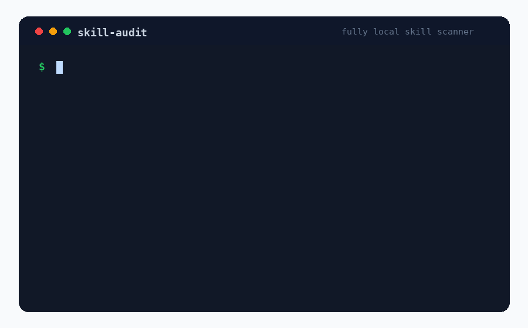

<p align="center">
  
</p>

<h1 align="center">skill-audit</h1>

<p align="center">
  Scan AI agent skills for prompt injection and malicious code, fully on your machine.<br/>
  No cloud upload, no hosted model, no account. Optional LLM review stays on localhost.
</p>

<p align="center">
  
  &nbsp;
  
  &nbsp;
  <a href="https://www.npmjs.com/package/@ondrej-merkun/skill-audit"></a>
  &nbsp;
  <a href="https://www.npmjs.com/package/@ondrej-merkun/skill-audit"></a>
  &nbsp;
  <a href="docs/PUBLISHING.md"></a>
  &nbsp;
  <a href=".github/SECURITY.md"></a>
  &nbsp;
  <a href="specs/RULES.md"></a>
  &nbsp;
  <a href="action.yml"></a>
  &nbsp;
  <a href="LICENSE"></a>
</p>

---

> **36% of agent skills ship with a security flaw. 13% with a critical one.**
> — [Snyk ToxicSkills study, Feb 2026](https://snyk.io/blog/toxicskills-malicious-ai-agent-skills-clawhub/)

`skill-audit` is a fully local scanner for AI-agent skills, plugins, MCP
configs, and project instruction files. It reads files from your machine, runs
shipped deterministic rules locally, and does not upload skill contents,
snippets, environment variables, or findings to a cloud service. It discovers
content exposed to Claude Code, OpenAI Codex, GitHub Copilot, Cursor, Gemini
CLI, Windsurf, Cline, OpenCode, Amp, OpenClaw, and cross-agent project files,
then shows the riskiest result first in a colorized verdict table.
When you want a deeper semantic pass, add optional localhost-only LLM review over
the same discovered skills: their deterministic findings, capped snippets, and
capped content of each skill's own files.

Run a one-off scan with `npx`, or install the `skill-audit` binary globally
before using the commands below, including local LLM review.
`npx` may fetch the package from npm. The scan itself runs locally after the CLI
starts.

```bash
# One-off scan
npx @ondrej-merkun/skill-audit

# Install globally
npm install -g @ondrej-merkun/skill-audit
skill-audit
```

Want deeper review without sending skills to a cloud model?

```bash
skill-audit llm add local --base-url http://127.0.0.1:11434/v1 --model llama3.1
skill-audit scan --llm local
```

Default scans make no network calls. Optional local LLM review uses your
loopback OpenAI-compatible server, labels model findings separately from rule
findings, and does not require a cloud account or remote model.

## Read The First Result

The default scan sorts findings by risk, so the first row is the next thing to
review.

```text
AGENT         SKILL                    SOURCE           VERDICT   SCORE   TOP ISSUE
Claude Code   docs-assistant           Direct           FAIL      40      Access to a known credential store path
Codex         webhook-exfil-skill      Plugin - alerts  FAIL      75      Known webhook endpoint
Cursor        csv-processor            Direct           PASS      100     —
```

- **FAIL** means a high-risk or mandatory-fail rule fired. Remove or review the
  skill before using it.
- **REVIEW** means risky patterns need human context, often in security
  training, test fixtures, or quoted examples.
- **PASS** means no shipped rule fired. It is not a guarantee that the skill is
  safe or current.

Investigate one row with:

```bash
skill-audit explain docs-assistant
```

## Common Commands

Scan and filter:

```bash
skill-audit                                          # default scan
skill-audit scan --agent claude-code                 # restrict discovery to one agent
skill-audit scan --skill docs-assistant              # scan one matching skill
skill-audit scan --include-marketplaces              # include inactive local marketplace inventory
skill-audit scan --scan-all-supporting-files         # paranoid supporting Markdown scan
```

Audit a skill before you install it:

```bash
skill-audit scan ./downloaded-skill                  # one skill, a skills repo, or a plugin checkout
skill-audit scan ./downloaded-skill/install.sh       # one file
```

A path scan does not look at installed skills. Each directory under the path
that holds a `SKILL.md` is one skill. The path is one more skill when it has
other files, such as plugin hooks or scripts. Supporting Markdown keeps its
normal severity, as with `--scan-all-supporting-files`. A path that does not
exist exits 2.

Write reports:

```bash
skill-audit scan --json -o skill-audit-report.json   # machine-readable JSON
skill-audit scan --summary -o skill-audit-summary.txt # compact text summary
skill-audit scan --html                              # standalone HTML report at scan.html
skill-audit scan --html skill-audit-report.html      # standalone HTML report at a custom path
skill-audit scan --sarif skill-audit.sarif           # SARIF 2.1.0 for GitHub code scanning
```

Add local LLM review:

```bash
skill-audit llm add local --base-url http://127.0.0.1:11434/v1 --model llama3.1
skill-audit llm list                                 # configured local models
skill-audit llm check local                          # local model health check
skill-audit scan --llm local                         # add local LLM review
skill-audit scan --skill docs-assistant --llm local   # review one skill with a local model
skill-audit scan --llm local --llm qwen              # compare multiple local models
skill-audit scan --llm all --html skill-audit-report.html
```

Inventory and follow up:

```bash
skill-audit list                                     # inventory without scanning
skill-audit list --include-marketplaces              # show installed and inactive marketplace skills
skill-audit explain <name>                           # inspect one result
skill-audit explain <name> --llm local               # inspect one result with local LLM review
skill-audit ignore <name>                            # suppress a reviewed tree hash
```

More workflows: [`docs/EXAMPLES.md`](docs/EXAMPLES.md).

## What It Covers

`skill-audit` scans global and project-local skill locations for Claude Code,
Codex, Copilot, Cursor, Gemini CLI, Windsurf, Cline, OpenCode, Amp, OpenClaw,
and instruction files such as `AGENTS.md`, `CLAUDE.md`, and Claude Code rules.
It also scans agent hook and settings files, agent plugin code, and each MCP
server definition, because those run commands. It matches 50 shipped rules
across prompt injection, network exfiltration, filesystem access, code
execution, obfuscation, hardcoded secrets, git-history access, dependency risk,
and skill-specific malware patterns.

Installed or currently exposed skills are the default scan and list surface.
Plugin marketplace payloads under `plugins/marketplaces/` are inactive local
inventory; include them only with `--include-marketplaces`, where output labels
rows as `installed` or `marketplace`. A cached Claude Code plugin in
`~/.claude/plugins/cache/` is scanned only when `installed_plugins.json`
records that version and `enabledPlugins` does not turn the plugin off.

## Optional Local LLM Review

The deterministic rule scanner is the baseline. If you already run a local
OpenAI-compatible model server, you can add LLM review as a second opinion:

```bash
skill-audit llm add local --base-url http://127.0.0.1:11434/v1 --model llama3.1
skill-audit llm check local
skill-audit scan --llm local
skill-audit explain docs-assistant --llm local
```

`skill-audit llm add` writes model config to
`$XDG_CONFIG_HOME/skill-audit/llms.json`, or `~/.config/skill-audit/llms.json`
when `XDG_CONFIG_HOME` is unset. Cloud model URLs are not accepted here. Base
URLs must use a loopback host: `localhost`, an address in `127.0.0.0/8`, or
`[::1]`. Names such as `ollama.localhost` or `127.0.0.1.example.com` are
rejected. No cloud API key, hosted account, or remote model is required.

Use the base URL that your server documents for OpenAI clients. It ends in
`/v1`, for example `http://127.0.0.1:11434/v1` for Ollama or
`http://127.0.0.1:1234/v1` for LM Studio. skill-audit sends requests to the
base URL plus `/chat/completions`. A base URL without
`/v1`, such as `http://127.0.0.1:11434`, is a server root: skill-audit adds
`/v1/chat/completions` to it.

For comparison runs, repeat `--llm`, pass comma-separated names, or use
`--llm all` for every enabled configured local model:

```bash
skill-audit scan --llm local --llm qwen
skill-audit scan --skill docs-assistant --llm local
skill-audit scan --llm local,qwen --summary
skill-audit scan --llm all --html skill-audit-report.html
```

LLM findings are labeled separately from deterministic rule findings. They do
not replace rule results, and model failures, timeouts, or invalid responses do
not hide scanner findings. Review payloads include skill metadata, deterministic
findings, capped snippets around the findings, and the skill's own files, after
obvious secret redaction. The entry file (`SKILL.md` or the target's main file)
comes first. Each file sends at most 4,000 characters, and the payload stays
within a total budget that `--context-tokens` sets. The payload marks each cut
file and lists the files that it did not send, so a skill without findings still
gets a model review. `skill-audit` does not send whole home directories, files
outside the skill, environment variables, or discovered secrets.

Detailed reference:

- [Discovery paths, comparison, scoring, JSON, CI, and FAQ](docs/REFERENCE.md)
- [Examples](docs/EXAMPLES.md)
- [Threat model and network boundary](docs/THREAT_MODEL.md)
- [Rule catalog](specs/RULES.md)
- [Allowlist maintenance](docs/ALLOWLIST.md)

## Use In CI

```bash
npx --yes @ondrej-merkun/skill-audit@latest scan \
  --json \
  --output skill-audit-results.json \
  --fail-on REVIEW
```

`--fail-on REVIEW` exits 1 for REVIEW or FAIL verdicts. The band is
case-insensitive. Any other value exits 2 with a usage error. The repository
also ships a GitHub Action:

```yaml
- uses: ondrej-merkun/skill-audit@v1
```

To show findings as GitHub code scanning alerts, set the action's `sarif-file`
input and upload that file with `github/codeql-action/upload-sarif`.

Set `scan-path` to audit the skills in the checkout before anyone installs them:

```yaml
- uses: ondrej-merkun/skill-audit@v1
  with:
    scan-path: skills
```

The action's `verdict` output is `PASS`, `REVIEW`, or `FAIL` when the scan
finishes. It is blank when the scan is incomplete (exit code 3) or when the CLI
stops with an error, for example a usage error.

See the [CI reference](docs/REFERENCE.md#use-in-ci) for the full workflow and
all action outputs. In
CI, `skill-audit` scans files locally inside the GitHub Actions runner and
writes report artifacts. It does not upload skill contents to a separate
analysis service.

## Limitations

`skill-audit` is a local scanner. It does not execute skills, sandbox tools, or
prove intent. Optional local LLM review can miss issues and can hallucinate
findings; deterministic rules remain the baseline scanner. The tool can miss
novel jailbreaks, runtime-fetched behavior, split-string obfuscation, and risks
in services that a skill calls later. Treat it as a fast first filter, not a
replacement for code review or dependency review.
